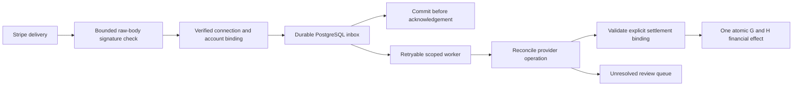

# Package K — provider events and reconciliation (FIN-02)

Status: **Proposed; local planning only, 2026-10-15.** The owner's `continue`
is interpreted as preparing the next package in the agreed
[stage-2 sequence](STAGE2_PLAN_2026-10-06.md). It is not an instruction to access a
Stripe account, create credentials or provider resources, move main, or enable a module.

Baseline: `df88c20687333668d39fe76a26eabca691e62cb0`, Package J technical acceptance,
[CI 158 PASS](https://github.com/alexeyalexandrov2026-tech/GORGONA-Booking-Platform_new/actions/runs/38697747829).
Local branch: `codex/package-k-plan`; checkout remains
`C:/Users/alexa/.codex/worktrees/package-j-review2-fixes/Gorgona Booking`.
Main remains `fedd0f115f24aad52f6256298296e8c5123fb427`.
This new K branch has no publication authorization: the existing exception covers J branches only.

[ADR-0027 (Proposed)](../adr/0027-provider-events-and-reconciliation.md),
[architecture and reuse evidence](evidence/2026-10-15-package-k-plan/ARCHITECTURE_REUSE.md),
[validation](evidence/2026-10-15-package-k-plan/VALIDATION.md),
[handoff](NEXT_AGENT_PACKAGE_K_PLAN_2026-10-15.md).

## Observable result and boundaries

FIN-02 requires that repeats and reordering of provider events never duplicate a
payment, refund or journal, and that the source operation remains traceable.
For an explicitly admitted test merchant, K would durably receive verified events,
process them with retries, link each supported financial effect to its provider
operation and internal obligation, and expose unresolved reconciliation work.

The recommended first integration follows the accepted SaaS/direct-charge ownership
model in [ADR-0024](../adr/0024-invoices-obligations-and-external-settlements.md):
the connected merchant owns the payment. K observes incoming payment and refund
facts; it does not introduce charge/refund initiation, transfers, payouts, split
checkout, platform commissions, tax calculation, FX or booking auto-confirmation.
A provider refund is a new fact linked to a previously issued refund obligation,
not an edit of the original payment or a fabricated H correction.

FIN-02 and STOCK-01 stay `planned`; ADR-0026 stays Proposed. The current FIN-01,
FIN-03 and WORK-01 acceptance is preserved. Technical evidence, operational
admission, product enablement and deployment are separate records.

## What already exists

- H4 records owner-supplied provider declarations. Its schema and contracts force
  charge/refund/transfer/payout capabilities to false; no verified test admission exists
  in that code. A submitted request never grants provider authority.
- H settlements reserve and confirm manually attested external money; G provides
  the book, currency scale, immutable journals and `gba.lock_ledger(tenant)`.
- Shared command receipts, audit, tenant transactions, permissions and schema guards
  are reusable mechanisms. Provider identity must outlive ordinary command receipts.
- Booking has no webhook route, Stripe adapter, provider event inbox/outbox or event
  worker in `api/src`. The separate AI jobs runtime is not a payment worker.
- The current host resolver is for live customer booking sites. Provider delivery
  must not require a merchant's storefront to be live or take tenant identity from metadata.

The [reuse evidence](evidence/2026-10-15-package-k-plan/ARCHITECTURE_REUSE.md)
names inspected files, candidates that cannot be reused unchanged, and current sources.

## Proposed flow

1. **Connection authority.** Introduce a separately verified, versioned binding of
   provider, platform/sandbox namespace, mode, connected account, business, legal
   entity, book, permitted observation operations and evidence. Store an opaque
   secret/configuration reference, never the credential. Only the authorized
   operator verification path can create positive operational evidence; H4 remains
   a declaration. Revocation is effective on the next worker transaction.
2. **Routing and trust.** A server-controlled ingress connection identifier selects
   the verification configuration. A minimal read-only routing record may expose
   only opaque connection/tenant IDs, following the existing `tenant_hosts` pattern;
   signature verification must finish before business data is touched. Cross-check
   the verified event account and environment against that connection. Untrusted
   request host, JSON metadata or a client-supplied business ID never grant scope.
   Any new routing privilege needs direct-SQL denial tests and review before adoption.
3. **Typed ingress.** Validate raw-body size, signature freshness, endpoint key
   versions and the supported provider API/event format. Use a versioned Pydantic
   normalized envelope. Unknown format/version goes to a bounded recorded refusal
   or quarantine, without financial effects. Choose and pin the event API version
   and official SDK only after Python 3.14 compatibility and license checks. Verify
   the delivery signature timestamp; an old event creation time alone is not replay proof.
4. **Durable receipt.** Proposed inbox key:
   `(provider, platform_or_sandbox, mode, connected_account, event_id)`.
   Record each delivery digest and only the payload fields needed for supported workflows;
   enforce immutable identity and a documented retention policy for sensitive data.
   Compare typed immutable event facts after signature verification: transport or
   serialization differences alone are not conflicting money facts. Same event key
   with inconsistent financial/account/object facts requires review, never overwrite.
   Return 2xx
   only after durable commit or a known durable duplicate; unavailable storage
   returns a retryable failure. Acknowledgement does not claim a payment was posted.
5. **Worker.** Claim a bounded batch with recoverable lease/attempt fencing. Persist
   attempts and typed errors. One financial transaction validates the lease, takes
   the ledger lock, applies the permissible operation and records its effect/result.
   Expired workers cannot commit after a newer claimant. No provider network call
   while a financial transaction or ledger lock is held. Pending retry, ignored,
   reconciled, applied and needs-review outcomes are explicit.
6. **Semantic identity and state.** Separate event identity from operation identity.
   One charge/payment fact has one canonical provider operation link; separate
   events for PaymentIntent and Charge cannot produce two effects. Each refund has
   its own refund ID, distinct from a payment. Stale delivery cannot regress state;
   do not rank lifecycle states by a numeric enum or event timestamp. Ambiguous,
   incomplete or incompatible facts require an account-scoped provider retrieval
   under admission and a repeatable reconciliation decision.
7. **Financial bridge.** Require an explicit, authorized binding of the provider
   object to the same merchant/book/currency and an existing reserved settlement;
   compare exact integer minor units and the actual successful amount. Do not infer
   allocations from email, customer name, booking price or arbitrary metadata.
   Reuse H cap/date/control-account checks through a reviewed shared posting
   primitive; do not call `settlements.confirm` with a forged manual attestation.
   Add provider provenance and journal lineage with a forward migration, retaining
   all existing manual-attestation contracts. SQL must require the verified operation,
   same-transaction effect and balanced journal together.
8. **Accounting limits.** A provider payment is not evidence of a bank payout or
   recognized revenue. The company explicitly selects its appropriate provider
   clearing/control accounts and posting date. Fees, net payout and gross collection
   are distinct. Use only provider/book currency combinations whose minor-unit
   interpretation is verified; discrepancies, closed periods, missing reserves,
   unsupported currencies or uncertain fees yield review without partial posting.
9. **Cross-path duplicates.** The object binding can explicitly link an already
   manually recorded payment only after matching scope, identity and exact amounts.
   Preserve its original manual provenance and append verification evidence; do not
   post again or relabel history. Unlinked manual references cannot prove whether
   the same physical money was recorded: quarantine the uncertainty rather than
   promise automatic semantic dedup across unrelated free text.
10. **Refunds and suspension.** Observe authorized successful refund facts against
    the existing H refund obligation and reserve; pending/failed events do not post.
    Partial refunds, duplicates and reordering preserve the cap and original payment.
    Unsupported disputes/chargebacks and unbound refunds create a reconciliation
    item, never a generic negative payment. On module/admission revocation, retain
    already-authenticated inbox/history/recovery and refuse new money effects;
    define and test receipt-only draining separately from operational processing.

Table names, route and worker models above are proposals, not existing interfaces.
The next migration is **0044**; recheck the maximum before implementation. Migrations
0001–0043 are immutable. No dependency, schema, worker or route is added by this plan.

## Reviewable slices

| Slice | Deliverable | Required evidence before advancing |
|---|---|---|
| K0 | Select the permitted test environment, merchant/book and operation scope; approve integration policy and verified-admission contract | Explicit owner authorization for provider/credential actions; actual safe test-admission evidence; never infer it from H4 |
| K1 | Typed signature adapter, scoped routing and durable inbox; new forward schema and guards | Red-to-green body/signature/account/mode tests, raw HTTP and SQL refusals, duplicate commit race, crash-before/after-ack proof |
| K2 | Bounded worker, fencing, operation identity and reconciliation decisions | Real concurrent claims/restarts, stale worker refusal, different events/one operation, reordering and provider failure; observed pg_locks waits for race claims |
| K3 | Provider provenance and atomic G/H payment/refund application | Direct SQL and API parity, cap and closed-period races, cross-path identity, no partial journals, existing H contract regression |
| K4 | Finance review UI and recovery, redacted metrics and operational runbook | Real desktop/mobile/axe; all list cursors; unknown outcome/retry/reconciliation UX; no false paid/verified labels |
| K5 | Complete FIN-02 evidence and separately authorized readiness decision | Actual admitted Stripe test execution, full disposable PostgreSQL suite, static/web/container gates, independent review, published exact-head CI |

K0 provider execution is **BLOCKED** by the standing separate provider/credential
authorization boundary. The plan and local architecture inspection are completeable
without those actions. Later local coding and publication scope must be made explicit
when the owner selects this proposal; no K branch push is authorized by the J exception.

## Acceptance matrix — all NOT TESTED

These are test requirements, not a statement that implementation exists.

| ID | Observable requirement | Status |
|---|---|---|
| K-01 | Modified/raw-body, missing/bad/stale signature and wrong verification key fail before tenant business reads, inbox acceptance or money effects | NOT TESTED |
| K-02 | Unknown/revoked account, mismatched merchant/tenant/book, test/live or sandbox mismatch fail closed; verified admission cannot be forged by H4/manual SQL | NOT TESTED |
| K-03 | Same event delivered repeatedly/concurrently has one durable inbox identity; ack lost after commit causes safe replay; delivery-only differences never duplicate effects, conflicting immutable facts are visible | NOT TESTED |
| K-04 | Different events and different object representations of one successful payment have one operation/effect/journal; duplicates survive receipt expiry | NOT TESTED |
| K-05 | All supported event permutations converge without payment-state regression; equal timestamps, stale snapshots and missing objects force safe reconciliation | NOT TESTED |
| K-06 | Tenant/book/currency/amount/binding/reserve must match; unsupported scales, overflows, negative/zero money and partial mismatches produce no partial posting | NOT TESTED |
| K-07 | Success, partial refund, failed/pending refund and duplicate/reordered refund events preserve the original payment and exact H obligations; no double refund effect | NOT TESTED |
| K-08 | Inbox, operation, ledger lineage and H cap cannot be bypassed by runtime/direct SQL; rollback leaves no partial financial effect | NOT TESTED |
| K-09 | Two workers, expired lease, crash/retry and period close have one legal outcome; every claimed race has an observed pg_locks wait with the intended blocker | NOT TESTED |
| K-10 | Existing manual attestation remains truthful; explicit prior-payment verification adds no duplicate journal; unresolved cross-path identity needs review | NOT TESTED |
| K-11 | Module/admission disablement prevents new effects while preserving history/recovery; schema/policy/function corruption refuses affected operations | NOT TESTED |
| K-12 | Worker retries/backoff/dead-letter/reconciliation remain bounded; provider timeout and cancellation never fabricate success; payloads/credentials/customer data stay out of logs and browser recovery | NOT TESTED |
| K-13 | Finance rights only; branch/delegate/support/foreign tenant refusals; real desktop/mobile/axe, complete pagination and safe action recovery | NOT TESTED |
| K-14 | Actual admitted Stripe test events plus static, unit, fresh PostgreSQL, browser, production-image CI, independent review and exact-SHA evidence; Booking/FIN-01/FIN-03/WORK-01/STOCK-01 regression | NOT TESTED |

## Decisions to resolve before implementation

Recommended defaults for a concrete owner review:

1. **Scope:** event observation and reconciliation for merchant-owned direct charges
   and refunds, with no payment/refund creation or new checkout. Any initiation path
   is a later explicitly selected slice.
2. **Test target:** one owner-selected test/sandbox merchant, legal-entity book and
   verified currency first; expand the explicit currency/operation matrix before
   broader acceptance. No production credentials or real funds.
3. **Ambiguity:** require explicit financial binding and human reconciliation of
   unbound/mismatched or previously manually attested facts. No automatic booking,
   revenue recognition, allocation guessing or period reopening.

After scope selection, the provider test authorization must name the environment,
account/operation boundaries and safe credential mechanism. Do not request secrets
in chat or documents. This requirement comes from the owner's explicit prohibition
on provider, funds and credential actions, and the stage-2 K admission prerequisite.
