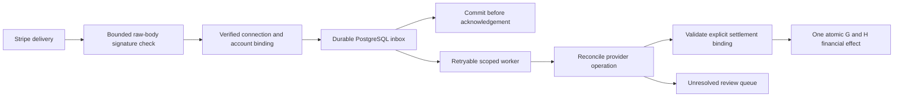

# Package K — provider events and reconciliation (FIN-02)

## K4a proposal — finance screen for provider operations (2026-10-18, docs only)

After K3a the owner was advised to take K4 before K3b. Its first part K4a (a finance region for
the book's provider operations and their state, clearing account registration, applying an
observed operation from a reserved settlement with the amount read-only from the facts, plain
refusals, unknown-outcome recovery, desktop/mobile/axe) is proposed in
[PACKAGE_K4A_DESIGN_2026-10-18.md](PACKAGE_K4A_DESIGN_2026-10-18.md). The owner answered on
2026-10-18: applying starts from the settlement, the clearing account is registered in the screen
after confirmation, a later conflict shows a marker (detail in K4b). Not started.

## Current checkpoint — 2026-10-17: K3a observed provider money into H locally verified

Source `2f91368271458d6f20030e43ab9409751c3fa62d` on local branch `codex/package-k3a-provider-money`, parent `1476108`.
Criteria M-01–M-11 PASS; migrations 0051–0052; 28 new cases. Final focused **777 passed in
626.41s (0:10:26)**; full **2182 passed, 4 skipped in 1723.33s (0:28:43)**. Kept failures:
product RED, three product defects found in development (plpgsql syntax, an ambiguous variable,
the receipt operation), two test defects, and a first full gate (1 failed: the strict web payment
contract). Not published.
[Validation](evidence/2026-10-17-k3a-provider-money/VALIDATION.md),
[CHECKS.json](evidence/2026-10-17-k3a-provider-money/CHECKS.json),
[handoff](NEXT_AGENT_PACKAGE_K3A_2026-10-17.md), [prompt](NEXT_AGENT_PACKAGE_K3A_PROMPT_2026-10-17.md).

### K3a design, recorded before code

Proposed in `6ba065c`; the owner answered on 2026-10-17: a finance user applies each observed
operation, one registered clearing account per connection, USD only, manual voids and
corrections allowed (recorded in `1476108` before the failing tests). Model and criteria
M-01–M-11 are in [PACKAGE_K3A_DESIGN_2026-10-17.md](PACKAGE_K3A_DESIGN_2026-10-17.md).
Implemented in `2f91368`. Not published.

## Previous checkpoint — 2026-10-17: K2a receipt decisions without money locally verified

Source `6e9bbfc74a09a5d472aaff25328356d6f71e8706` on local branch `codex/package-k2a-receipt-decisions`, parent `b6c8040`.
Criteria W-01–W-11 PASS; migration 0050; 59 new cases. Final focused **571 passed in 478.99s
(0:07:58)**; full **2154 passed, 4 skipped in 1765.52s (0:29:25)**. Kept failures: product RED,
a test-helper defect, and a first focused gate (8 failed) where two older tests did not know
the 0050 objects. No money moves. Not published.
[Validation](evidence/2026-10-17-k2a-receipt-decisions/VALIDATION.md),
[CHECKS.json](evidence/2026-10-17-k2a-receipt-decisions/CHECKS.json),
[handoff](NEXT_AGENT_PACKAGE_K2A_2026-10-17.md), [prompt](NEXT_AGENT_PACKAGE_K2A_PROMPT_2026-10-17.md).

### K2a design, recorded before code

Local branch `codex/package-k2a-receipt-decisions` from `b6c8040`. The owner answered the four
questions: a separate `gba_receipt_worker` group, every conflict to manual review, direct payments
and refunds only, unattested events never processed. Model (migration 0050, bootstrap, worker,
guard) and criteria W-01–W-11 are in
[PACKAGE_K2A_DESIGN_2026-10-17.md](PACKAGE_K2A_DESIGN_2026-10-17.md). Implemented in `6e9bbfc`.
Not published.

## Previous checkpoint — 2026-10-17: K1k TRUNCATE guard and random route IDs locally verified

Source `a5f21e41f550d5d07e428c644e9f718082b3f619` on local branch `codex/package-k1k-truncate-guard`, parent `ae9e1e2`.
Criteria T-01–T-04 PASS; migration 0049; 18 new cases. Final focused **512 passed in 443.01s
(0:07:23)**; full **2095 passed, 4 skipped in 1656.78s (0:27:36)**. Kept failures: a test defect
(plain TRUNCATE of a referenced table stops at its foreign keys first) and product RED. Closes
IR-09 and the default part of IR-08. Not published.
[Validation](evidence/2026-10-17-k1k-truncate-guard/VALIDATION.md),
[CHECKS.json](evidence/2026-10-17-k1k-truncate-guard/CHECKS.json),
[handoff](NEXT_AGENT_PACKAGE_K1K_2026-10-17.md), [prompt](NEXT_AGENT_PACKAGE_K1K_PROMPT_2026-10-17.md).

### K1k design, recorded before code

Local branch `codex/package-k1k-truncate-guard` from `ae9e1e2` (K1j docs). The owner, away, asked
to keep working and decide alone; the remaining small review findings are IR-08 and IR-09.
Implemented in `a5f21e4` (T-01 uses TRUNCATE … CASCADE, see the validation). Not published.

IR-09: the K tables are permanent for UPDATE and DELETE even for the owner and a superuser, but
`TRUNCATE` (also `TRUNCATE … CASCADE` from a referenced table) empties them; the runtime and the
writer hold no TRUNCATE privilege, the owner and a superuser do. IR-08: `ingress_id` has no
default, so every provisioning must choose one.

Decisions (migration 0049):

1. **No TRUNCATE.** A new `gba.reject_provider_receipt_truncate()` (plpgsql,
   `search_path=pg_catalog`, no PUBLIC execute) raises `check_violation`; a `BEFORE TRUNCATE
   FOR EACH STATEMENT` trigger `<table>_no_truncate` calls it on all six K tables. A cascade
   from `ledger_books` is refused the same way.
2. **Random route IDs by default.** `provider_receipt_routes.ingress_id` defaults to
   `gen_random_uuid()`; an explicit ID is still accepted. The ID stays non-secret (the signature
   authenticates).
3. **Guard.** The receipt schema guard expects the six triggers, the function and the default;
   a missing or disabled trigger or a changed default refuses receipts and archives.
4. Out of scope: TRUNCATE guards on other tables (ledger, stock), a superuser who switches
   `session_replication_role` or drops triggers, per-route disable, listing routes.
   Migrations 0001–0048 unchanged.

Acceptance criteria (failing tests first):

| id | Requirement |
|---|---|
| T-01 | TRUNCATE of each K table by the owner and by a superuser is refused (`check_violation`), also `TRUNCATE gba.ledger_books CASCADE`; every row stays |
| T-02 | A route provisioned without `ingress_id` gets a random version-4 UUID; two such routes differ; it routes a receipt |
| T-03 | Drift (a dropped or disabled truncate trigger, the default removed) refuses receipts and archives; repaired schema passes |
| T-04 | Existing K and guard tests and the full suite stay green |

## Previous checkpoint — 2026-10-17: K1j revocation record locally verified

Source `201847856aa768bbeb25751d5b219e154383c293` on local branch `codex/package-k1j-revocation-record`, parent `84bc4d7`.
Criteria J-01–J-07 PASS; migration 0048; 21 new cases. Final focused **494 passed in 358.27s
(0:05:58)**; full **2077 passed, 4 skipped in 1598.78s (0:26:38)**. Kept failure: product RED
(21 failed; an attestation after `SET ROLE` recorded the group). Closes IR-07 except the
namespace limit. Not published.
[Validation](evidence/2026-10-17-k1j-revocation-record/VALIDATION.md),
[CHECKS.json](evidence/2026-10-17-k1j-revocation-record/CHECKS.json),
[handoff](NEXT_AGENT_PACKAGE_K1J_2026-10-17.md), [prompt](NEXT_AGENT_PACKAGE_K1J_PROMPT_2026-10-17.md).

### K1j design, recorded before code

Local branch `codex/package-k1j-revocation-record` from `84bc4d7` (K1i docs). The owner, away,
asked to keep working on the plan and decide alone; the next item by the plan is review finding
IR-07. Implemented in `2018478`. Not published.

IR-07: revocation of a receipt connection or a verification config is a bare boolean (no who,
when or why), so rotation cannot be told from compromise; `verified_by` and `created_by` record
`current_user`, which after `SET ROLE` is the group, not the login.

Decisions (migration 0048):

1. **Who, when and why.** Both tables get `revoked_reason`, `revoked_at` and `revoked_by`.
   Reasons: configs `rotation`, `compromise`, `retired`; connections `compromise`, `retired`. A
   revocation must name its reason (`UPDATE … SET revoked=true, revoked_reason=…`); the trigger
   writes `revoked_at := now()` and `revoked_by := session_user` (the login). Grants become
   `UPDATE (revoked, revoked_reason)` for the runtime and the writer; `revoked_at`/`revoked_by`
   are never granted.
2. **Permanent.** After revocation no revocation field changes; before it none may be set; the
   identity rule is unchanged. A check constraint keeps the three fields all set or all empty and
   empty while not revoked.
3. **Earlier revocations stay honest.** A row revoked before 0048 keeps its three fields empty
   (meaning: revoked, record unknown). The trigger refuses a new revocation without a reason, so
   no new row reaches that state. No backfill, no invented values; the upgrade keeps every row.
4. **Attribution by login.** The attestation and config triggers record `session_user` in
   `verified_by` and `created_by` (equal to `current_user` without `SET ROLE`).
5. **Guard.** The receipt schema guard reads 0048: the new columns, checks, column grants and
   the replaced function bodies; drift refuses receipts and archives as before.
6. Out of scope: re-provisioning a revoked connection in the same namespace (unique
   `namespace, account_id`, a K2 constraint), any effect of `compromise` on earlier
   attestations (K2 reconciliation), an API or CLI for revocation. Migrations 0001–0047 unchanged.

Acceptance criteria (failing tests first):

| id | Requirement |
|---|---|
| J-01 | A revocation without a reason, or with a reason outside its table's set, is refused for the runtime and the writer; nothing changes |
| J-02 | A revocation with a reason records the reason, a time within the transaction and the session login — also after `SET ROLE gba_receipt_writer` |
| J-03 | After revocation the reason, time and author cannot change and revocation cannot be undone; before it they cannot be set; `revoked_at`/`revoked_by` cannot be written directly |
| J-04 | Attestations and configs record the session login after `SET ROLE` |
| J-05 | Upgrade 0047 → 0048 with revoked rows keeps all rows and prior checksums; earlier revocations keep empty fields |
| J-06 | Guard drift (a grant on `revoked_by`, a dropped revocation check, the 0046 config trigger body) refuses receipts and archives; repaired schema passes |
| J-07 | Existing K and guard tests and the full suite stay green |

## Previous checkpoint — 2026-10-17: K1i stock posting plans independent of statistics locally verified

Source `42ead59a3ff975d0daa6ee294af6b34b2b8ce5ff` on local branch `codex/package-k1i-stock-plan-stability`, parent `0760553`.
Criteria I-01–I-04 PASS; migration 0047; 5 new cases. Final focused **473 passed in 329.46s (0:05:29)**;
full **2056 passed, 4 skipped in 1556.26s (0:25:56)**; one document's check reads at most 1 row per
stock-table node with a 100,016-row history (red: 100,031). Kept failures: product RED, and a first
full run that still read the history through the line check's equalities (fixed by decision 2a).
Not published. [Validation](evidence/2026-10-17-k1i-stock-plan-stability/VALIDATION.md),
[CHECKS.json](evidence/2026-10-17-k1i-stock-plan-stability/CHECKS.json),
[handoff](NEXT_AGENT_PACKAGE_K1I_2026-10-17.md), [prompt](NEXT_AGENT_PACKAGE_K1I_PROMPT_2026-10-17.md).

### K1i design, recorded before code

Local branch `codex/package-k1i-stock-plan-stability` from `0760553` (the K1h finding). The owner
asked to fix the stock error first and then continue the K plan. This touches STOCK-01 code
(ADR-0026). Implemented in `42ead59` (decision 2a added after gates-1).

Root cause (K1h): when statistics do not describe a company, every index that starts with
`tenant_id` is estimated at one row; a check of one document can then use an index that does not
contain the document and read the history. Two such competitors exist on the history tables:
`stock_movements_sequence_key` and `stock_valuations_sequence_key` (PostgreSQL 18 can also use
them by skip scan when the company is not their first column). `stock_document_lines_returned`
is partial (`source_document_id is not null`) and not a competitor. Separately, three triggers
join a return's source document without parameterizing the lookup by its id.

Decisions:

1. **History keys that cannot serve a company predicate.** Migration 0047 replaces both unique
   constraints by unique indexes of the same names: material, place/owner and sequence first,
   then the company as the expression `(tenant_id::text)`. The uniqueness is identical (the text
   of a uuid is one-to-one); the running-total lookups by material, place, owner and latest
   sequence keep their index; no plan can use these indexes for `tenant_id = …`, so a lookup by
   company and document can only use the document key. Item ids are chosen by clients and unique
   only per company, so the company must stay in the key (dropping it was rejected in K1h).
2. **Source lookups by key.** `guard_stock_document_line`, `apply_stock_movement` and
   `apply_stock_valuation` read a return's source document through
   `LEFT JOIN LATERAL (… where x.tenant_id=d.tenant_id and x.id=d.source_document_id limit 1)`;
   the bodies are otherwise the 0040/0042 texts.
2a. **Line check without history-key equalities (added after gates-1, diag-1).** In the full
   order the line check of `assert_stock_document` still read the history: its join compared the
   movement's material, place and owner with equalities, which the new key (material first) can
   serve, and a material absent from the statistics again looked like one row. 0047 also replaces
   `assert_stock_document` with these comparisons written as `IS NOT DISTINCT FROM` (all columns
   NOT NULL, same meaning), leaving the document key as the only usable index.
3. **Guard.** `inventory_guard.py` approves a constraint that a later migration drops, and the
   two unique indexes by their exact `pg_get_indexdef` text (valid, ready, unique); a missing or
   altered index refuses inventory work.
4. **Deterministic test.** `test_stock_scale` analyzes the stock tables on a short history before
   timing, keeps its 3× + 50 ms threshold and adds a load-independent check: `auto_explain` of
   `gba.assert_stock_document` for the last posting, as the runtime role, may touch at most 100
   rows of any stock table per plan node with a 100,016-row history. Upgrade tests reach the
   latest migration and name the package K tables of 0044–0046.
5. No rule, row, grant or threshold change; 0001–0046 unchanged.

Acceptance criteria (failing test first):

| id | Requirement |
|---|---|
| I-01 | The plan check reads at most 100 rows per stock-table node with stale statistics (red on the current code) |
| I-02 | The timing check passes with the unchanged threshold — alone, in the stock group **and in the full suite order** |
| I-03 | Dropping or altering either history index, or restoring the old constraint, refuses inventory work |
| I-04 | Existing stock, guard and upgrade tests and the full suite stay green |

## Finding — 2026-10-17: K1h stock posting plans under misleading statistics (fixed in K1i)

Diagnosed on `codex/package-k1h-stock-scale-timing` (docs only; all code attempts reverted at the
owner's choice). `test_stock_scale` fails in full runs because of a real planner hazard, not
load: when statistics do not describe the company, PostgreSQL may reach one document's rows
through another company-leading index and read the whole history. Three fixes were tried and
recorded; none held in the full order. The robust fix — document checks by full primary keys
only — is a larger, separately reviewed slice. [Finding](evidence/2026-10-17-k1h-stock-statistics/FINDING.md).
Fixed in K1i (`42ead59`, above) without full-key rewrites: the history keys no longer serve a
company predicate and the line check no longer uses their equalities.

## Previous checkpoint — 2026-10-17: K1g receipt guard additions locally verified

Source `4401a2e7bcdc716eaa5664285c0ca383ddf77163` on local branch `codex/package-k1g-guard-additions`, parent `af26f1d`. Criteria
G-01–G-05 PASS; 10 new cases; no migration. Final focused **468 passed in 294.65s (0:04:54)**;
full **2052 passed, 4 skipped in 2011.34s (0:33:31)**. Kept failures: product RED (10 failed),
a design defect in dev-1 (`relhasrules` stays true after `DROP RULE`), and a first full run that
failed once on the pre-existing, near-limit stock timing test. Not published.
[Validation](evidence/2026-10-17-k1g-guard-additions/VALIDATION.md),
[CHECKS.json](evidence/2026-10-17-k1g-guard-additions/CHECKS.json),
[handoff](NEXT_AGENT_PACKAGE_K1G_2026-10-17.md), [prompt](NEXT_AGENT_PACKAGE_K1G_PROMPT_2026-10-17.md).

### K1g design, recorded before code

Local branch `codex/package-k1g-guard-additions` from `af26f1d` (K1f docs). The owner asked for the
next small slice, review finding IR-05, in the same order (design, failing test, gates, records).
Not published.

**K1g: receipt schema guard additions — local only.** IR-05: the guard checks the two groups'
privileges but not who belongs to them; it does not look at rewrite rules, table persistence,
grants to third roles, grant options or function ACLs beyond PUBLIC; and the writer path never
checks `gba.current_tenant_id()`/`gba.current_location_id()`, on which every K policy depends.

Decisions (all in `assert_provider_receipt_ready`, so both the writer and the runtime archive
path refuse on drift with the existing `DatabaseUnavailableError`):

1. **Role topology.** `gba_runtime` and `gba_receipt_writer` are NOLOGIN without SUPERUSER,
   BYPASSRLS, CREATEROLE, CREATEDB or REPLICATION and belong to no other role; no role is a
   member (directly or through other roles) of both groups; no member of either group is a
   superuser or has BYPASSRLS. Membership is read from `pg_auth_members`, not `pg_has_role`, so
   superusers do not appear as members. This also closes IR-05 (a): a runtime login that holds
   writer membership is refused by the guard itself.
2. **Tables.** The six K tables are ordinary (`relkind r`), logged (`relpersistence p`) and have
   no rewrite rules (read from `pg_rewrite`; `relhasrules` stays true after `DROP RULE`). Table and column ACL grantees are only the table owner, `gba_runtime` and
   `gba_receipt_writer`; only the owner holds grant options.
3. **Functions.** The K functions' ACL grantees are only the owner and the two groups, without
   grant options for anyone but the owner.
4. **Context functions.** `gba.current_tenant_id()` and `gba.current_location_id()` are checked
   by exact packaged source and shape (SQL, stable, parallel safe, no SECURITY DEFINER, no
   settings, no arguments, `uuid`) and the same ACL rule.
5. No migration (0047 stays free), no dependency, no receipt-flow change.

Acceptance criteria (failing tests first):

| id | Requirement |
|---|---|
| G-01 | Each drift refuses the routed writer receipt and the runtime archive with `DatabaseUnavailableError`, stores nothing, and the repaired schema passes again: runtime login granted the writer group; a parent role granted to the writer group; a BYPASSRLS login in the writer group |
| G-02 | Same, for a rewrite rule on a K table and an unlogged K table |
| G-03 | Same, for a table grant to a third role, a grant option to `gba_runtime`, and a function grant to a third role |
| G-04 | Same, for a replaced `current_location_id()` body and for `current_tenant_id()` made SECURITY DEFINER |
| G-05 | Existing guard, K1a–K1f tests and the full suite stay green |

## Previous checkpoint — 2026-10-17: K1f bootstrap hardening locally verified

Source `3e18c938a505bbb4583778cdf40df0e7bed2aceb` on local branch `codex/package-k1f-bootstrap-hardening`, parent `be97fbd`. Criteria
F-01–F-04 PASS; 8 new cases; no migration. Focused **458 passed in 408.78s (0:06:48)**; full
**2042 passed, 4 skipped in 3100.84s (0:51:40)**; static, mypy (315 files), web and build PASS;
runtime audit 0; existing development audit 5 high FAIL. Kept failure: product RED (7 failed).
Not published. K1e branch CI: run 38991120703 FAILED at the production image build after 17 s (log needs a GitHub sign-in; pinned base images were pullable afterwards); an empty re-run commit `e5279cb` (same tree as `be97fbd`) passed: [CI run 38996263458](https://github.com/alexeyalexandrov2026-tech/GORGONA-Booking-Platform_new/actions/runs/38996263458) SUCCESS. The first failure is treated as transient; its cause is not established.
[Validation](evidence/2026-10-17-k1f-bootstrap-hardening/VALIDATION.md),
[CHECKS.json](evidence/2026-10-17-k1f-bootstrap-hardening/CHECKS.json),
[handoff](NEXT_AGENT_PACKAGE_K1F_2026-10-17.md), [prompt](NEXT_AGENT_PACKAGE_K1F_PROMPT_2026-10-17.md).

### K1f design, recorded before code

Local branch `codex/package-k1f-bootstrap-hardening` from `be97fbd` (K1e plus the disk-cleanup
note). After the K1e handoff asked which follow-up to take, the owner answered «continue»; the
recommended first follow-up was review finding IR-06. Not published (the push authorization
covered the K1e branch only).

**K1f: writer bootstrap and migration order — local only.** IR-06: `BootstrapSpec.validate()`
accepts equal owner, runtime and writer passwords, so a runtime credential holder could log in as
the writer; `gba-db bootstrap` cannot create the writer login; a database bootstrapped before
K1c lacks `gba_receipt_writer`, and `migrate` then fails inside 0045 after 0044 was applied.

Decisions:

1. **Distinct passwords.** `validate()` refuses any two equal passwords among owner, runtime and
   writer, before any connection; the message names no value.
2. **Writer login from the CLI.** `gba-db bootstrap` reads optional `GBA_RECEIPT_WRITER_ROLE` and
   `GBA_RECEIPT_WRITER_PASSWORD` from the environment, both or neither; neither keeps today's
   behavior. The existing `bootstrap()` creates the login and its group membership. Output names
   roles only.
3. **Bootstrap before migrate.** `apply_migrations` checks, before taking the migration lock or
   creating anything, that the groups `gba_runtime` and `gba_receipt_writer` exist; otherwise it
   refuses with "run gba-db bootstrap before migrate" and applies nothing. `gba-db migrate`
   prints `MigrationError` as an operator message instead of a traceback.
4. **Docs.** `docs/DEVELOPMENT.md` documents the order, the writer variables and a credentials row
   for the writer login. The Azure bootstrap job (`infra/azure/modules/containerapps.bicep`) is
   not changed: infrastructure and secrets need the owner's separate word; recorded as a limit.
5. No migration (0047 stays free), no dependency, no change to receipt code or schema.

Acceptance criteria (failing tests first):

| id | Requirement |
|---|---|
| F-01 | Equal owner/runtime, owner/writer or runtime/writer passwords are refused by `validate()` and by `bootstrap()` before any connection; no password appears in the message |
| F-02 | `gba-db bootstrap` with both writer variables creates a login that is a member of `gba_receipt_writer` and passes the K1c writer-role check shape (not a runtime member, not the owner); with one variable it refuses; with none no writer login is created |
| F-03 | `migrate` on a cluster where `gba_receipt_writer` is missing refuses before applying anything (no `gba_schema_migrations` table, no `gba` schema) and names the bootstrap step; after the group is back the same database migrates fully |
| F-04 | Existing bootstrap and migration tests and the full suite stay green |

## Previous checkpoint — 2026-10-16: K1e raw HTTP ingress locally verified

Source `eb46748fa7446754e96e9290ce5261607ae45ce0` on local branch `codex/package-k1e-http-ingress`,
parent `2d434bf`. A separate writer-process ASGI application and the reordered
`receive_routed_receipt` implement decisions 1–9 below; criteria E-01–E-13 PASS on synthetic
data. 46 new cases; no migration. Final focused **450 passed in 273.91s (0:04:33)**; full
**2034 passed, 4 skipped in 1700.22s (0:28:20)**; static, mypy (314 files), web 114 and build
PASS; runtime audit 0; existing development audit 5 high FAIL; 3 container and 1 tenant-site
skips NOT TESTED. Kept failures: a product RED on the K1d code (unbounded lock wait, share locks
before the signature) and a design gap found in dev-1 (the ordinary runtime lost the K1c
writer-role refusal; fixed with a cheap membership check). The owner-approved independent
read-only review of K1a–K1d found no High, two Medium (both addressed here) and nine Low/Note
findings. Human review, K CI, process entry point and the real provider are NOT TESTED or
BLOCKED. FIN-02/STOCK-01 planned; ADR-0026/0027 Proposed; K not published; next migration 0047.
[Validation](evidence/2026-10-16-k1e-http-ingress/VALIDATION.md),
[CHECKS.json](evidence/2026-10-16-k1e-http-ingress/CHECKS.json),
[review](evidence/2026-10-16-k1e-http-ingress/INDEPENDENT_REVIEW_K1A_K1D.md),
[handoff](NEXT_AGENT_PACKAGE_K1E_2026-10-16.md), [prompt](NEXT_AGENT_PACKAGE_K1E_PROMPT_2026-10-16.md).

### K1e design, recorded before code

Local branch `codex/package-k1e-http-ingress` from `2d434bff8081e03d38765caa0b61f5df006dde27` (K1d docs).
The owner answered with the handoff prompt for K1e and chose an independent read-only review of
K1a–K1d by a separate agent, run in parallel with K1e. The review found no High issue, two
Medium (IR-01, IR-02) and nine Low/Note findings; dispositions are in decision 9 and the
[review record](evidence/2026-10-16-k1e-http-ingress/INDEPENDENT_REVIEW_K1A_K1D.md).
Decision 9 and criteria E-12/E-13 were added after the review, still before code.

**K1e: raw HTTP receipt ingress — local, synthetic only.**

Decisions:

1. **Separate writer process.** A new ASGI application, built by
   `create_receipt_ingress_app(pool, key_store, limits=…)`, serves exactly one route:
   `POST /v1/provider-events/stripe/{ingress_id}`. It runs with the receipt writer pool and the
   server-held key store. The ordinary application (`create_app`) gets no receipt route and never
   holds the writer credential or keys; its runtime role guard already refuses writer membership.
   No settings, process entry point, container or deployment is added: pool and key store are
   injected. No OpenAPI or other routes in the ingress application.
2. **Bounded raw body.** Order: route and method → ingress ID syntax → a free concurrency slot →
   `Content-Length` check → streamed read with a running cap → `receive_routed_receipt`. The body
   cap is K1a's 256 KiB; over it → 413 (before reading by `Content-Length`, otherwise as soon as
   the cap is passed, also when chunked). Reading the body has a time budget; over it → 408.
   Exactly one `Stripe-Signature` header; none or several is a refusal. No framework JSON
   parsing: the exact bytes reach the K1a check.
3. **Acknowledgement.** 200 with one fixed body, only after `receive_routed_receipt` returned,
   that is after the commit: for a recorded event, a known duplicate and a verified conflicting
   variant (it is durably retained for review). No IDs, disposition or digest in the response.
   A lost acknowledgement is safe: the retry finds a duplicate, adds no rows and gets 200.
4. **One refusal.** Unknown or malformed ingress, missing, repeated, bad or stale signature, wrong
   or unusable key, revoked config or connection, wrong account, version, type or shape, an empty
   body and a foreign company's event: 400 with one byte-identical body, without a reason, IDs or
   references. The request ID is only in `X-Request-ID`. The K1a refusal reason is never sent.
5. **Retryable failure.** Storage unavailable — pool timeout, lost connection, lock or statement
   timeout, serialization failure, deadlock, schema or writer-role guard refusal — and a full
   concurrency quota: 503 with `Retry-After` and one fixed body. Any other failure, including a
   failed commit: 500 with one fixed body. Never 2xx before the commit.
6. **Quotas, per process.** Body 256 KiB and signature header 4096 bytes (K1a constants), a body
   read budget, a bounded number of concurrent receipts (a full quota answers 503 without reading
   the body), and transaction-local `lock_timeout` and `statement_timeout` set by
   `receive_routed_receipt` before its first query. Per-source rate limits at the edge and durable
   per-connection volume quotas are recorded limits; they need real traffic data (K0).
7. **Retention.** Stored rows keep only typed minimal facts, the delivery digest, the config ID
   and the writer attribution: no raw body, signature header, key, client address or ingress ID.
   Event identities, deliveries and attestations are kept permanently: they are the duplicate
   identity that must outlive receipts (K-04) and the audit trail; immutability triggers forbid
   deletion. No automatic deletion in K1e; a legal retention period is an owner decision before
   production. Logs keep the existing policy: route template, status, duration, request ID; never
   the body, headers or the ingress ID from the path.
8. **No schema change.** K1e needs no migration; 0047 stays free.
9. **Cheap unauthenticated path** (added after the
   [independent review](evidence/2026-10-16-k1e-http-ingress/INDEPENDENT_REVIEW_K1A_K1D.md), IR-01).
   Before the signature check `receive_routed_receipt` only sets its timeouts, checks cheaply that
   the session belongs to the writer group and not to the runtime (`pg_has_role`; the ordinary
   runtime still gets the K1c writer-role refusal), and reads the route, then the active config
   and binding, without row locks and without the catalog guards. After a
   valid signature it runs the writer-role and schema guards, re-reads the config and binding
   under FOR SHARE and refuses unless they are the same active config and binding; only then it
   archives and attests. An unknown ingress costs one indexed read; a bad signature takes no row
   lock and no catalog scan. This corrects the K1d claim: there, an unknown ingress also paid for
   two catalog queries, and a bad signature took share locks. The review's other findings
   (IR-03–IR-11) are recorded limits; IR-02 is decision 4; for IR-04 a K0 prerequisite is that
   the endpoint subscribes only to the 11 supported event types.

Acceptance criteria (failing tests first):

| id | Requirement |
|---|---|
| E-01 | A signed delivery over HTTP to a routed ingress returns 200 with the fixed body; archive and attestation are already committed when the response arrives; no journal rows. Also over a real loopback HTTP socket |
| E-02 | The same delivery again (acknowledgement lost) returns 200 and adds no rows; a verified conflicting variant returns 200 and is retained as a conflict delivery |
| E-03 | Unknown and malformed ingress, missing, repeated, bad and stale signature, wrong key, revoked config, revoked connection, a foreign company's account, an unsupported type and an empty body return 400 with a byte-identical body; nothing is stored |
| E-04 | A body over the cap returns 413: by `Content-Length` without reading, and chunked as soon as the cap is passed (also over a real socket); nothing is stored |
| E-05 | A body that does not arrive within the read budget returns 408; nothing is stored |
| E-06 | Storage unavailable: an exhausted writer pool returns 503 with `Retry-After`; a receipt connection terminated while it waits on a lock (observed `pg_locks` wait) returns 503; nothing is stored; the retry after recovery returns 200 |
| E-07 | A failure at commit returns 500 with the fixed body; nothing is stored |
| E-08 | Quotas: with every slot busy the next request returns 503 without reading its body; a receipt blocked by a held revocation lock longer than its lock timeout returns 503 (observed `pg_locks` wait) and stores nothing |
| E-09 | Schema or writer-role drift returns 503 and stores nothing |
| E-10 | Only `POST` on the one route; other methods and paths are refused; the ordinary application has no receipt route |
| E-11 | Stored rows and captured logs contain no raw body, signature header, key or ingress ID; full suite green |
| E-12 | While a revocation of the route's config is held uncommitted, a bad signature is refused at once: before the refusal no statement takes a row lock or scans the catalog |
| E-13 | A config revoked, or rotated to a new version, between the unlocked read and the locked re-read is refused; nothing is stored |

Limits: synthetic fixtures only; no provider account or key, process entry point, deployment,
worker or money. Connections stay `not_admitted`. K-01–K-14 stay NOT TESTED: E-01–E-13 are
partial local evidence for K-01 and K-03. FIN-02/STOCK-01 planned; ADR-0026/0027 Proposed;
0001–0046 unchanged; K not published.

## Previous checkpoint — 2026-10-16: K1d verification authority and routing locally verified

Source `e9c86bfbd1d22e00ea66a96637cd98e9a58f27b4` on local branch `codex/package-k1d-receipt-routing`,
parent `46ab31d`. Migration 0046 and the routed entry point implement decisions 1–8 below;
criteria D-01–D-09 PASS on synthetic data. 60 new cases, 28 K1c cases ported. Final focused
**404 passed in 267.91s (0:04:27)**; full **1988 passed, 4 skipped in 1970.01s (0:32:50)**;
static, mypy (312 files), web 114 and build PASS; runtime audit 0; existing development audit
5 high FAIL; 3 container and 1 tenant-site skips NOT TESTED. Kept failures include a genuine
design defect: a validated key added by the migration owner did not see rows hidden by forced
row security, so 0046 checks under a temporary owner policy. Independent review, K CI, HTTP
ingress and the real provider are NOT TESTED or BLOCKED. FIN-02/STOCK-01 planned; ADR-0026/0027
Proposed; K not published; next migration 0047.
[Validation](evidence/2026-10-16-k1d-receipt-routing/VALIDATION.md),
[CHECKS.json](evidence/2026-10-16-k1d-receipt-routing/CHECKS.json),
[handoff](NEXT_AGENT_PACKAGE_K1D_2026-10-16.md), [prompt](NEXT_AGENT_PACKAGE_K1D_PROMPT_2026-10-16.md).

### K1d design, recorded before code

The owner answered «ok» to the offer to take the K1c handoff: review K1c, then design
and build the next small local slice. Branch `codex/package-k1d-receipt-routing` from
`46ab31dd6f41ae820a85a09f19fd5812584fc89d`. The K1d executor's
[K1c review](evidence/2026-10-16-k1d-receipt-routing/K1C_AUTHOR_REVIEW.md) is not
independent; it found the two gaps K1d closes: the attested verification-config ID
is unanchored (R1) and there is no server-controlled routing (R2).

**K1d: verification-config authority and trusted routing — local, synthetic only.**

Decisions:

1. **Authority.** Migration 0046 adds `gba.provider_verification_configs`: per
   connection, versioned (the trigger assigns previous + 1), at most one active
   version per connection, an opaque `secret_ref` in `store:name` form, never a key.
   A value that looks like a Stripe secret is refused. Rows are immutable except a
   one-way revocation; a config cannot be created for a revoked connection.
   Company-scoped RLS like the other K tables; `created_by` records the database principal.
2. **Who may create and revoke.** Only the database owner (the operator path) creates
   configs and routes, inside an explicit company context. No grant, role or
   security-definer function lets the runtime or the writer create, change or
   reactivate them. Runtime and writer may revoke: it only removes authority, and the
   writer's FOR SHARE needs UPDATE(revoked), as for connections.
3. **Not admission.** A config states which key may verify deliveries for a connection.
   It is not operational admission: connections stay `not_admitted` and test-mode only.
   No positive operational evidence is created; H4 stays a declaration.
4. **Routing.** `gba.provider_receipt_routes` maps a server-generated opaque ingress ID
   to company and connection IDs only; one route per connection; immutable. It follows
   the `tenant_hosts` pattern, but narrower: only `gba_receipt_writer` may read it
   without a company context; the runtime has no access.
5. **One entry point.** `receive_routed_receipt(pool, ingress_id, raw, signature,
   key_store=…)` replaces K1c's caller-supplied `ReceiptVerifierBinding`, which is removed.
   Order: writer role and schema guard → route → company context from the route →
   active config and connection binding under FOR SHARE → key by `secret_ref` from the
   server-held key store (missing → refuse) → K1a raw-body check against the
   connection's namespace, account and API version → K1b archive → attestation with the
   config ID → commit → result. Before the signature check only authority rows (route,
   config, binding) are read; no inbox, ledger or business rows. Every refusal is one
   generic error without IDs, references or keys.
6. **Anchored attestation.** A composite key (company, connection, config ID) from
   attestations to configs, plus an insert trigger that takes FOR SHARE on the config and
   refuses a revoked or foreign one. Revocation waits for in-flight receipts and applies
   from the next transaction.
7. **Upgrade.** An existing K1c attestation has no authority behind it, so 0046 refuses to
   apply instead of back-filling or relabelling. K1c was never published or deployed; such
   rows exist only in disposable test databases. The refusal is an explicit check under a
   temporary owner policy (the 0042 precedent), dropped in the same transaction: a test
   showed that adding the validated key alone does not see rows that forced row security
   hides from the owner.
8. **Guards.** The schema guard covers the two tables, new functions, triggers, policies
   (by role name), the partial unique index and per-role privileges. Writer-role safety
   covers six tables.

Acceptance criteria (failing tests first):

| id | Requirement |
|---|---|
| D-01 | A routed receipt commits archive and attestation with the active config ID; no journal rows |
| D-02 | Unknown ingress, missing key, wrong key, revoked config and revoked connection refuse with no rows |
| D-03 | Company A's ingress with an event for company B's account refuses; no rows in either company |
| D-04 | Rotation: v1 revoked, v2 active as version 2; a delivery signed only with the old key refuses, the new one records v2; two active versions are refused |
| D-05 | Direct SQL: runtime cannot create, change, delete or reactivate configs, nor read or write routes; writer cannot create configs or routes, nor attest with a missing, foreign or revoked config; owner cannot provision without company context; secret-like refs and configs for revoked connections are refused; routes and configs are immutable |
| D-06 | Config revocation waits behind an in-flight receipt (observed `pg_locks` wait); the receipt commits; the next receipt refuses |
| D-07 | 0045 with an attestation: 0046 fails and 0045 stays intact. Nonempty 0045 without attestations upgrades with rows unchanged |
| D-08 | Schema drift (runtime read grant on routes, dropped partial index, changed route policy, changed config trigger) makes guarded operations refuse |
| D-09 | Existing K1c tests run through the routed entry point and pass; full suite green |

Limits: synthetic fixtures only (fake `acct_` IDs, keys generated in memory); no HTTP
route, provider account or key, worker or money; no config expiry (rotation is an
operator action). K-01–K-14 stay NOT TESTED: D-01–D-08 are partial local evidence for
K-01/K-02. FIN-02/STOCK-01 planned; ADR-0026/0027 Proposed; 0001–0045 immutable; K not published.

## Previous checkpoint — 2026-10-16: K1c receipt attestations locally verified

Source `0c72a719cb9743a1f3cd7d60ea26bc46e9e2638c`,branch `codex/package-k1c-receipt-attestations`,base `f5f7987a534a518f3019b7aced28be970f18ad0d`.0045 adds protected per-delivery
verifier attestations;ordinary archive remains untrusted. Dedicated writer validates
raw K1a signatures before DB,refuses unsafe role ancestry/session context and commits
archive+attestation before result.40 new tests,2 observed pg_locks waits,no auth backfill.
Focused **369 passed in 322.44s (0:05:22)**;full **1930 passed, 4 skipped in 1685.52s (0:28:05)**;static/mypy309/web114/build PASS.
Runtime audit0 PASS;existing development5high FAIL;4 container/external skips.
No HTTP/global routing/operational admission/worker/money. Full K acceptance,independent
review,production isolation and exact K CI NOT TESTED. FIN-02/STOCK-01 planned;
ADR0026/0027 Proposed. K local only;main=fedd0f1,published J=df88c20. Next0046.
[Validation](evidence/2026-10-16-k1c-receipt-attestations/VALIDATION.md),
[reuse](evidence/2026-10-16-k1c-receipt-attestations/ARCHITECTURE_REUSE.md),
[handoff](NEXT_AGENT_PACKAGE_K1C_2026-10-16.md),[prompt](NEXT_AGENT_PACKAGE_K1C_PROMPT_2026-10-16.md).

## Previous checkpoint — 2026-10-15: K1b schema guard review locally verified

Local source `db96f005442201428700995c09f028e1b6da08c0` on `codex/package-k1b-guard-review`, base `84d4177e97ebc16e1743dcb995abf54c1b81269d`. Six schema conformance gaps
were reproduced before the correction; the existing guard now binds approved trigger
identity/shape, shared immutable source, FK parent schema and column PUBLIC privileges.
Focused **316 passed in 106.89s (0:01:46)**; full **1890 passed, 4 skipped in 1454.00s (0:24:14)**; static/build/web114 PASS.
No migration/dependency/ingress/worker/money authority. FIN-02/STOCK-01 planned;
ADR0026/0027 Proposed; full K acceptance/independent review/exact K CI NOT TESTED.
Runtime npm audit0 PASS, existing development5high FAIL;4 container/external skips.
K remains local; main=fedd0f1 and published J=df88c20 unchanged.
[Validation](evidence/2026-10-15-k1b-guard-review/VALIDATION.md),
[review](evidence/2026-10-15-k1b-guard-review/REVIEW.md),
[handoff](NEXT_AGENT_PACKAGE_K1B_REVIEW_2026-10-15.md),
[prompt](NEXT_AGENT_PACKAGE_K1B_REVIEW_PROMPT_2026-10-15.md).

## Previous checkpoint — 2026-10-15: local K1b storage foundation

Source `543b73221ac1dd0aa738bd8cf33dd468366ef27a`; full 1884 passed, 4 skipped in 1502.59s (0:25:02); focused 252 passed in 79.86s (0:01:19);40 new tests PASS.
Migration0044 and the internal repository implement receipt-only bindings, immutable
event identity, distinct deliveries/conflicts, rollback/replay, three observed pg_locks
races, RLS denials and a nonempty0043 upgrade. The binding always says `not_admitted`;
it is not the proposed verified operational connection. No HTTP route/acknowledgement,
global routing lookup, worker or money effect. Complete K1 and K-01–K-14 NOT TESTED.
Next migration0045;0001–0044 immutable in this local history.
[Evidence](evidence/2026-10-15-k1b-receipt-inbox/VALIDATION.md),
[current handoff](NEXT_AGENT_PACKAGE_K1B_2026-10-15.md).
The proposal and K1a statements below describe their historical baselines.

## Execution checkpoint — 2026-10-15: K1a only

A later owner `continue` was interpreted as proceeding with the bounded local offline
foundation, without provider actions. K1a is locally implemented in `7d25aa2d72874271a62e363817e0624fb502497c`: 96 synthetic signature/
decoder tests, focused 191 passed in 53.85s, full 1844 passed, 4 skipped in 1444.23s (0:24:04), static/build/web114 PASS.
[Evidence](evidence/2026-10-15-k1a-event-boundary/VALIDATION.md),
[current handoff](NEXT_AGENT_PACKAGE_K1A_2026-10-15.md).
The complete K1 and all K-01–K-14 remain NOT TESTED. FIN-02/STOCK-01 stay planned,
ADR-0027 Proposed; no K push/CI or actual admission. K1b connection/inbox and K2/K3
worker/effects remain ahead. Planning-baseline statements below describe e8783f6's
proposal; only the offline boundary and pinned SDK now exist.

Status: **Proposed; local planning only, 2026-10-15.** The owner's `continue`
is interpreted as preparing the next package in the agreed
[stage-2 sequence](STAGE2_PLAN_2026-10-06.md). It is not an instruction to access a
Stripe account, create credentials or provider resources, move main, or enable a module.

Baseline: `df88c20687333668d39fe76a26eabca691e62cb0`, Package J technical acceptance,
[CI 158 PASS](https://github.com/alexeyalexandrov2026-tech/GORGONA-Booking-Platform_new/actions/runs/38697747829).
Local branch: `codex/package-k-plan`; checkout remains
`C:/Users/alexa/.codex/worktrees/package-j-review2-fixes/Gorgona Booking`.
Main remains `fedd0f115f24aad52f6256298296e8c5123fb427`.
This new K branch has no publication authorization: the existing exception covers J branches only.

[ADR-0027 (Proposed)](../adr/0027-provider-events-and-reconciliation.md),
[architecture and reuse evidence](evidence/2026-10-15-package-k-plan/ARCHITECTURE_REUSE.md),
[validation](evidence/2026-10-15-package-k-plan/VALIDATION.md),
[handoff](NEXT_AGENT_PACKAGE_K_PLAN_2026-10-15.md).

## Observable result and boundaries

FIN-02 requires that repeats and reordering of provider events never duplicate a
payment, refund or journal, and that the source operation remains traceable.
For an explicitly admitted test merchant, K would durably receive verified events,
process them with retries, link each supported financial effect to its provider
operation and internal obligation, and expose unresolved reconciliation work.

The recommended first integration follows the accepted SaaS/direct-charge ownership
model in [ADR-0024](../adr/0024-invoices-obligations-and-external-settlements.md):
the connected merchant owns the payment. K observes incoming payment and refund
facts; it does not introduce charge/refund initiation, transfers, payouts, split
checkout, platform commissions, tax calculation, FX or booking auto-confirmation.
A provider refund is a new fact linked to a previously issued refund obligation,
not an edit of the original payment or a fabricated H correction.

FIN-02 and STOCK-01 stay `planned`; ADR-0026 stays Proposed. The current FIN-01,
FIN-03 and WORK-01 acceptance is preserved. Technical evidence, operational
admission, product enablement and deployment are separate records.

## What already exists

- H4 records owner-supplied provider declarations. Its schema and contracts force
  charge/refund/transfer/payout capabilities to false; no verified test admission exists
  in that code. A submitted request never grants provider authority.
- H settlements reserve and confirm manually attested external money; G provides
  the book, currency scale, immutable journals and `gba.lock_ledger(tenant)`.
- Shared command receipts, audit, tenant transactions, permissions and schema guards
  are reusable mechanisms. Provider identity must outlive ordinary command receipts.
- Booking has no webhook route, Stripe adapter, provider event inbox/outbox or event
  worker in `api/src`. The separate AI jobs runtime is not a payment worker.
- The current host resolver is for live customer booking sites. Provider delivery
  must not require a merchant's storefront to be live or take tenant identity from metadata.

The [reuse evidence](evidence/2026-10-15-package-k-plan/ARCHITECTURE_REUSE.md)
names inspected files, candidates that cannot be reused unchanged, and current sources.

## Proposed flow

1. **Connection authority.** Introduce a separately verified, versioned binding of
   provider, platform/sandbox namespace, mode, connected account, business, legal
   entity, book, permitted observation operations and evidence. Store an opaque
   secret/configuration reference, never the credential. Only the authorized
   operator verification path can create positive operational evidence; H4 remains
   a declaration. Revocation is effective on the next worker transaction.
2. **Routing and trust.** A server-controlled ingress connection identifier selects
   the verification configuration. A minimal read-only routing record may expose
   only opaque connection/tenant IDs, following the existing `tenant_hosts` pattern;
   signature verification must finish before business data is touched. Cross-check
   the verified event account and environment against that connection. Untrusted
   request host, JSON metadata or a client-supplied business ID never grant scope.
   Any new routing privilege needs direct-SQL denial tests and review before adoption.
3. **Typed ingress.** Validate raw-body size, signature freshness, endpoint key
   versions and the supported provider API/event format. Use a versioned Pydantic
   normalized envelope. Unknown format/version goes to a bounded recorded refusal
   or quarantine, without financial effects. Choose and pin the event API version
   and official SDK only after Python 3.14 compatibility and license checks. Verify
   the delivery signature timestamp; an old event creation time alone is not replay proof.
4. **Durable receipt.** Proposed inbox key:
   `(provider, platform_or_sandbox, mode, connected_account, event_id)`.
   Record each delivery digest and only the payload fields needed for supported workflows;
   enforce immutable identity and a documented retention policy for sensitive data.
   Compare typed immutable event facts after signature verification: transport or
   serialization differences alone are not conflicting money facts. Same event key
   with inconsistent financial/account/object facts requires review, never overwrite.
   Return 2xx
   only after durable commit or a known durable duplicate; unavailable storage
   returns a retryable failure. Acknowledgement does not claim a payment was posted.
5. **Worker.** Claim a bounded batch with recoverable lease/attempt fencing. Persist
   attempts and typed errors. One financial transaction validates the lease, takes
   the ledger lock, applies the permissible operation and records its effect/result.
   Expired workers cannot commit after a newer claimant. No provider network call
   while a financial transaction or ledger lock is held. Pending retry, ignored,
   reconciled, applied and needs-review outcomes are explicit.
6. **Semantic identity and state.** Separate event identity from operation identity.
   One charge/payment fact has one canonical provider operation link; separate
   events for PaymentIntent and Charge cannot produce two effects. Each refund has
   its own refund ID, distinct from a payment. Stale delivery cannot regress state;
   do not rank lifecycle states by a numeric enum or event timestamp. Ambiguous,
   incomplete or incompatible facts require an account-scoped provider retrieval
   under admission and a repeatable reconciliation decision.
7. **Financial bridge.** Require an explicit, authorized binding of the provider
   object to the same merchant/book/currency and an existing reserved settlement;
   compare exact integer minor units and the actual successful amount. Do not infer
   allocations from email, customer name, booking price or arbitrary metadata.
   Reuse H cap/date/control-account checks through a reviewed shared posting
   primitive; do not call `settlements.confirm` with a forged manual attestation.
   Add provider provenance and journal lineage with a forward migration, retaining
   all existing manual-attestation contracts. SQL must require the verified operation,
   same-transaction effect and balanced journal together.
8. **Accounting limits.** A provider payment is not evidence of a bank payout or
   recognized revenue. The company explicitly selects its appropriate provider
   clearing/control accounts and posting date. Fees, net payout and gross collection
   are distinct. Use only provider/book currency combinations whose minor-unit
   interpretation is verified; discrepancies, closed periods, missing reserves,
   unsupported currencies or uncertain fees yield review without partial posting.
9. **Cross-path duplicates.** The object binding can explicitly link an already
   manually recorded payment only after matching scope, identity and exact amounts.
   Preserve its original manual provenance and append verification evidence; do not
   post again or relabel history. Unlinked manual references cannot prove whether
   the same physical money was recorded: quarantine the uncertainty rather than
   promise automatic semantic dedup across unrelated free text.
10. **Refunds and suspension.** Observe authorized successful refund facts against
    the existing H refund obligation and reserve; pending/failed events do not post.
    Partial refunds, duplicates and reordering preserve the cap and original payment.
    Unsupported disputes/chargebacks and unbound refunds create a reconciliation
    item, never a generic negative payment. On module/admission revocation, retain
    already-authenticated inbox/history/recovery and refuse new money effects;
    define and test receipt-only draining separately from operational processing.

Table names, route and worker models above are proposals, not existing interfaces.
The next migration is **0044**; recheck the maximum before implementation. Migrations
0001–0043 are immutable. No dependency, schema, worker or route is added by this plan.

## Reviewable slices

| Slice | Deliverable | Required evidence before advancing |
|---|---|---|
| K0 | Select the permitted test environment, merchant/book and operation scope; approve integration policy and verified-admission contract | Explicit owner authorization for provider/credential actions; actual safe test-admission evidence; never infer it from H4 |
| K1 | Typed signature adapter, scoped routing and durable inbox; new forward schema and guards | Red-to-green body/signature/account/mode tests, raw HTTP and SQL refusals, duplicate commit race, crash-before/after-ack proof |
| K2 | Bounded worker, fencing, operation identity and reconciliation decisions | Real concurrent claims/restarts, stale worker refusal, different events/one operation, reordering and provider failure; observed pg_locks waits for race claims |
| K3 | Provider provenance and atomic G/H payment/refund application | Direct SQL and API parity, cap and closed-period races, cross-path identity, no partial journals, existing H contract regression |
| K4 | Finance review UI and recovery, redacted metrics and operational runbook | Real desktop/mobile/axe; all list cursors; unknown outcome/retry/reconciliation UX; no false paid/verified labels |
| K5 | Complete FIN-02 evidence and separately authorized readiness decision | Actual admitted Stripe test execution, full disposable PostgreSQL suite, static/web/container gates, independent review, published exact-head CI |

K0 provider execution is **BLOCKED** by the standing separate provider/credential
authorization boundary. The plan and local architecture inspection are completeable
without those actions. Later local coding and publication scope must be made explicit
when the owner selects this proposal; no K branch push is authorized by the J exception.

## Acceptance matrix — all NOT TESTED

These are test requirements, not a statement that implementation exists.

| ID | Observable requirement | Status |
|---|---|---|
| K-01 | Modified/raw-body, missing/bad/stale signature and wrong verification key fail before tenant business reads, inbox acceptance or money effects | NOT TESTED |
| K-02 | Unknown/revoked account, mismatched merchant/tenant/book, test/live or sandbox mismatch fail closed; verified admission cannot be forged by H4/manual SQL | NOT TESTED |
| K-03 | Same event delivered repeatedly/concurrently has one durable inbox identity; ack lost after commit causes safe replay; delivery-only differences never duplicate effects, conflicting immutable facts are visible | NOT TESTED |
| K-04 | Different events and different object representations of one successful payment have one operation/effect/journal; duplicates survive receipt expiry | NOT TESTED |
| K-05 | All supported event permutations converge without payment-state regression; equal timestamps, stale snapshots and missing objects force safe reconciliation | NOT TESTED |
| K-06 | Tenant/book/currency/amount/binding/reserve must match; unsupported scales, overflows, negative/zero money and partial mismatches produce no partial posting | NOT TESTED |
| K-07 | Success, partial refund, failed/pending refund and duplicate/reordered refund events preserve the original payment and exact H obligations; no double refund effect | NOT TESTED |
| K-08 | Inbox, operation, ledger lineage and H cap cannot be bypassed by runtime/direct SQL; rollback leaves no partial financial effect | NOT TESTED |
| K-09 | Two workers, expired lease, crash/retry and period close have one legal outcome; every claimed race has an observed pg_locks wait with the intended blocker | NOT TESTED |
| K-10 | Existing manual attestation remains truthful; explicit prior-payment verification adds no duplicate journal; unresolved cross-path identity needs review | NOT TESTED |
| K-11 | Module/admission disablement prevents new effects while preserving history/recovery; schema/policy/function corruption refuses affected operations | NOT TESTED |
| K-12 | Worker retries/backoff/dead-letter/reconciliation remain bounded; provider timeout and cancellation never fabricate success; payloads/credentials/customer data stay out of logs and browser recovery | NOT TESTED |
| K-13 | Finance rights only; branch/delegate/support/foreign tenant refusals; real desktop/mobile/axe, complete pagination and safe action recovery | NOT TESTED |
| K-14 | Actual admitted Stripe test events plus static, unit, fresh PostgreSQL, browser, production-image CI, independent review and exact-SHA evidence; Booking/FIN-01/FIN-03/WORK-01/STOCK-01 regression | NOT TESTED |

## Decisions to resolve before implementation

Recommended defaults for a concrete owner review:

1. **Scope:** event observation and reconciliation for merchant-owned direct charges
   and refunds, with no payment/refund creation or new checkout. Any initiation path
   is a later explicitly selected slice.
2. **Test target:** one owner-selected test/sandbox merchant, legal-entity book and
   verified currency first; expand the explicit currency/operation matrix before
   broader acceptance. No production credentials or real funds.
3. **Ambiguity:** require explicit financial binding and human reconciliation of
   unbound/mismatched or previously manually attested facts. No automatic booking,
   revenue recognition, allocation guessing or period reopening.

After scope selection, the provider test authorization must name the environment,
account/operation boundaries and safe credential mechanism. Do not request secrets
in chat or documents. This requirement comes from the owner's explicit prohibition
on provider, funds and credential actions, and the stage-2 K admission prerequisite.
